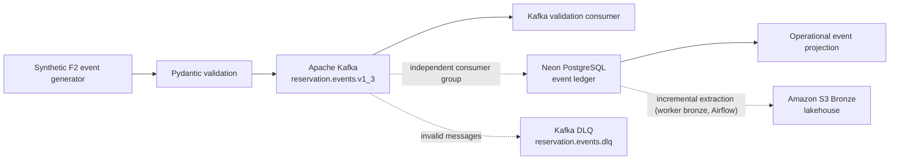

# 🏨 HospedaPlus | Hotel Reservation Streaming Platform

<p align="center">
  <strong>Real-time reservation event processing for the HospedaPlus data platform.</strong><br/>
  <em>HospedaPlus · Data Engineering · F2 Channel-Manager Simulation</em>
</p>

<p align="center">
  
  
  
  
</p>

> [!IMPORTANT]
> **Status: active development.** The default branch contains the Kafka producer, versioned event contract, validation consumer, and an isolated Neon event-ledger sink. Live Neon persistence, production retry behavior, and cloud deployment must not be considered complete until their migrations, integration tests, and runtime checks have been executed and reviewed.

## Project overview

Buenavista Streaming is the synthetic **F2 channel-manager event source** for the HospedaPlus data platform. It creates realistic, schema-validated reservation lifecycle events for a simulated hospitality portfolio and publishes them to Apache Kafka.

The system is Kafka-first. Kafka is the sole message broker supported by this repository; legacy broker implementations and configuration are not part of the maintained application.

### Hospitality context

| Dimension | Definition |
| --- | --- |
| Business domain | Hotel reservations and channel-manager activity |
| Simulated portfolio | 28 hotels across five countries; 4,000 rooms |
| Source domain | F2 — channel-manager events |
| Event format | Versioned JSON validated with Pydantic |
| Current event contract | **1.3** |
| Canonical reference data | Pinned catalog from `HospedaPlus/db_simulated` |
| Privacy | Synthetic data only; no direct guest identifiers or payment data |
| Main branch | `main` |

## Architecture



Solid lines represent the current producer and validation path. The Neon consumer and sink are implemented separately but still require live integration verification. Kafka has a single storage sink, Neon: the lakehouse receives F2 events when the Airflow worker bronze extracts `reservation_event_ledger` from Neon into S3 Bronze, like the other Neon tables. Cloud deployment remains pending.

## Event lifecycle

The simulator supports six reservation event types:

| Event type | Meaning |
| --- | --- |
| `reservation.created` | A reservation is created |
| `reservation.updated` | Reservation details are modified |
| `reservation.cancelled` | A reservation is cancelled |
| `reservation.no_show` | The guest does not arrive |
| `reservation.checked_in` | The guest checks in |
| `reservation.checked_out` | The guest checks out |

The contract includes a stable `event_id`, `schema_version`, `hotel_id`, `reservation_id`, and `reservation_version`. Consumers must deduplicate by event ID and reconcile lifecycle order using reservation version. See [`docs/event-contract.md`](docs/event-contract.md).

The F2 `reservation_id` is not the integer primary key of F3's reservations table. F3 mappings and status translations must be explicitly approved; do not fabricate guest identifiers or financial values.

## Technology stack

| Technology | Responsibility |
| --- | --- |
| Python 3.12+ | Event generation and consumers |
| Pydantic 2 | Event schema validation |
| Apache Kafka / `confluent-kafka` | Streaming producer and consumers |
| PostgreSQL on Neon | Intended OLTP event ledger |
| Amazon S3 | Lakehouse Bronze, fed from Neon by the Airflow worker bronze (outside this repository) |
| Docker Compose | Local Kafka environment |
| pytest and Ruff | Tests, linting, and formatting |
| GitHub Actions | Continuous integration |

## Quick start

### Prerequisites

- Python 3.12 or newer
- Git
- Docker Desktop with Docker Compose v2
- PowerShell, Bash, or Zsh

### 1. Clone and install

**Windows PowerShell**

```powershell
git clone https://github.com/HospedaPlus/buenavista-streaming.git
cd buenavista-streaming
py -3.12 -m venv .venv
.\.venv\Scripts\Activate.ps1
python -m pip install --upgrade pip
python -m pip install -e ".[dev]"
Copy-Item .env.example .env
```

**macOS / Linux**

```bash
git clone https://github.com/HospedaPlus/buenavista-streaming.git
cd buenavista-streaming
python3.12 -m venv .venv
source .venv/bin/activate
python -m pip install --upgrade pip
python -m pip install -e ".[dev]"
cp .env.example .env
```

Never commit real passwords, API keys, cloud credentials, or database connection URLs. Keep local `.env` files out of Git.

### 2. Start Kafka

```powershell
docker compose -f docker-compose.kafka.yml config
docker compose -f docker-compose.kafka.yml up -d
docker compose -f docker-compose.kafka.yml ps
```

Inspect logs if the broker does not become healthy:

```powershell
docker compose -f docker-compose.kafka.yml logs --tail 100
```

### 3. Create the reservation topic

```powershell
docker exec buenavista-streaming-kafka /opt/kafka/bin/kafka-topics.sh --bootstrap-server localhost:9092 --create --if-not-exists --topic reservation.events.v1_3 --partitions 3 --replication-factor 1
docker exec buenavista-streaming-kafka /opt/kafka/bin/kafka-topics.sh --bootstrap-server localhost:9092 --create --if-not-exists --topic reservation.events.dlq --partitions 1 --replication-factor 1
```

The single-broker setup is for local development, not high availability.

### 4. Publish events

Bounded batch (sends 20 events as fast as possible and stops):

```powershell
python -m src.kafka_producer --count 20 --seed 42
```

Continuous stream (5 events/s, with a 15 events/s peak during the first 10 s of every minute; stop with Ctrl+C or `--duration`):

```powershell
python -m src.kafka_producer --continuous --duration 120
```

High-season simulation: extra demand for one hotel and stay window (repeat `--surge` for more hotels):

```powershell
python -m src.kafka_producer --continuous --surge HP-PT-003:2026-10-20:2026-10-26:3.0
```

Other options: `--base-rate`, `--peak-rate`, `--peak-every`, `--peak-duration`, `--occupancy` (default 0.68) and `--out-of-order-rate` (default 0.05). The producer logs the best events-per-second second it observed.

The producer uses `reservation_id` as the Kafka message key, so all events of a reservation land in the same partition. It uses `acks=all` and idempotence. Successful delivery confirms broker acceptance, not downstream persistence.

### 5. Run the validation consumer

In a second terminal with the virtual environment activated:

```powershell
python -m src.kafka_consumer
```

The validation consumer parses events with Pydantic and logs safe metadata. It does not persist anything. Invalid messages remain uncommitted and stop the current consumer; a production retry/dead-letter workflow remains a required acceptance item.

### 6. Run the Neon ledger consumer (optional)

Before running this component, the team must approve and apply `migrations/001_create_reservation_event_ledger.sql` through the database migration process. This additive migration is designed for the streaming-owned event ledger and must not be assumed to have been applied to the shared Neon project.

Set `NEON_DATABASE_URL` in an untracked local `.env` file or approved secret store, then run:

```powershell
python -m src.neon_consumer
```

The consumer commits a Kafka offset only after the Neon transaction succeeds. Duplicate event IDs with identical payloads are treated as already persisted; a conflicting payload for the same ID raises an error. Database failures leave the offset uncommitted for replay. Messages that fail validation are copied to `reservation.events.dlq` (with the error in a header) and the stream continues.

**Live Neon persistence has not been verified in this session.** Do not claim it is operational until the migration, connection, and integration behavior are verified.

### 7. Run quality checks

```powershell
ruff check .
ruff format --check .
pytest
```

Record actual command results for each change; do not mark checks as passing without evidence.

## Configuration

The `.env.example` file contains Kafka settings and an optional Neon URL placeholder. Store credentials only in local untracked environment files or the approved deployment secret manager.

## Neon and lakehouse integration

Kafka has one storage sink:

1. **Neon OLTP:** persist the immutable event in `reservation_event_ledger` and commit its Kafka offset only after the database transaction succeeds.
2. **Lakehouse:** the Airflow worker bronze extracts new ledger rows incrementally (by `received_at`) from Neon into S3 Bronze. That job lives in the data-platform repository, not here.

Before production use, validate the schema migration, permissions, idempotency, replay behavior, retries, dead-letter handling, and monitoring.

## Security and privacy

- Use synthetic reservation data only.
- Never commit guest names, contact details, payment data, credentials, or real connection strings.
- Use least-privilege roles for Kafka and Neon.
- Redact secrets from logs and error reports.
- Rotate any credential that may have been exposed; deleting it from the latest file does not remove it from Git history.

## Repository guide

| Path | Purpose |
| --- | --- |
| `src/events.py` | Event schema and synthetic lifecycle generation |
| `src/kafka_producer.py` | Kafka event publisher |
| `src/kafka_consumer.py` | Kafka validation consumer |
| `src/neon_consumer.py` | Independent consumer for Neon event-ledger persistence |
| `src/neon_sink.py` | Idempotent Neon event-ledger persistence |
| `docker-compose.kafka.yml` | Local Kafka environment |
| `docs/event-contract.md` | Versioned event contract and mapping constraints |
| `migrations/001_create_reservation_event_ledger.sql` | Proposed additive event-ledger schema; requires review before applying |
| `tests/` | Automated test suite |
| `.env.example` | Configuration template without real credentials |

## Delivery checklist

- [x] Publish synthetic F2 event contract version 1.3 (guest reference, loyalty tier, nightly rate, local hotel time).
- [x] Continuous mode with peaks (≥ 10 events/s) and demand calibrated to 68% occupancy, with demand surges.
- [x] Add Kafka producer and validation consumer.
- [x] Add local Kafka Compose configuration.
- [x] Add an isolated Neon event-ledger sink and consumer to `main`.
- [ ] Run full tests and Ruff checks on the current default-branch commit.
- [ ] Run Kafka broker integration tests from a clean environment.
- [ ] Review and apply the Neon event-ledger migration through the approved process.
- [ ] Verify live Neon persistence with integration tests.
- [x] Single storage path: Kafka → Neon ledger; the lakehouse reads the ledger from Neon.
- [x] Dead-letter topic for invalid messages in the Neon consumer.
- [ ] Apply the inventory projection (`reservar()` / `liberar()`) in the same transaction as the ledger insert.
- [ ] Validate replay, idempotency, and offset behavior end to end.
- [ ] Confirm deployment ownership, security, monitoring, and budget before production use.

## Definition of done

Production readiness requires passing automated checks, an agreed event contract, verified Neon persistence, secure credential management, demonstrated failure recovery, and documented deployment and monitoring ownership. Until then, this project remains in development.

---

<p align="center">
  <strong>🏨 Buenavista Streaming · HospedaPlus</strong><br/>
  <sub>Thoughtful data engineering for dependable hospitality experiences.</sub>
</p>
