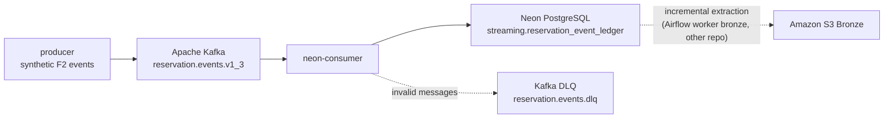

# 🏨 HospedaPlus | Buenavista Streaming (F2)

<p align="center">
  <strong>Synthetic hotel-reservation event stream: Kafka → Neon PostgreSQL.</strong><br/>
  <em>HospedaPlus · Data Engineering · F2 Channel-Manager Source</em>
</p>

<p align="center">
  
  
  
  
</p>

## Contents

1. [What this project does](#what-this-project-does)
2. [Project status](#project-status)
3. [Architecture](#architecture)
4. [Run it with Docker (recommended)](#run-it-with-docker-recommended)
5. [See what it is doing](#see-what-it-is-doing)
6. [Stop, restart and reset](#stop-restart-and-reset)
7. [Troubleshooting](#troubleshooting)
8. [Configuration](#configuration)
9. [Event contract](#event-contract)
10. [Local development without Docker](#local-development-without-docker)
11. [Deploying to AWS](#deploying-to-aws)
12. [Repository guide](#repository-guide)
13. [Security and privacy](#security-and-privacy)
14. [Roadmap](#roadmap)

## What this project does

Buenavista Streaming simulates **F2, the channel-manager source** of the HospedaPlus data platform. It generates realistic reservation lifecycle events for 28 hotels (4,000 rooms in five countries). It publishes them to Apache Kafka, and a consumer stores every event in **Neon PostgreSQL**.

| Dimension | Definition |
| --- | --- |
| Business domain | Hotel reservations from OTAs and other channels |
| Event types | created, updated, cancelled, no-show, checked-in, checked-out |
| Throughput | Continuous: 5 events/s, with a 15 events/s peak for 10 s every minute |
| Demand model | Calibrated to 68% occupancy and a 50% OTA share; optional demand surges |
| Realism | Multiple modifications, late cancellations, no-shows, ~5% out-of-order events |
| Event format | Versioned JSON (contract **1.3**) validated with Pydantic |
| Storage | `streaming.reservation_event_ledger` in Neon (idempotent, one row per event) |
| Reproducibility | Same `--seed` → same events |
| Privacy | Synthetic data only; pseudonymous guest reference, no names, contact details or payment data |

## Project status

| Component | Status |
| --- | --- |
| Event generator and contract 1.3 | ✅ Done, covered by tests |
| Kafka producer (batch and continuous, `acks=all`, idempotent) | ✅ Done |
| Kafka → Neon consumer, with DLQ for invalid messages | ✅ Done, verified against Neon (dev branch) |
| One-command Docker environment | ✅ Done |
| Inventory projection (`reservar()` / `liberar()`) in Neon | ⏳ Pending: needs the F3 inventory tables |
| Cloud deployment (MSK + ECS Fargate) | ⏳ Pending |

## Architecture



- **One storage path.** Kafka writes only to Neon. The lakehouse gets F2 when the Airflow worker bronze extracts new ledger rows from Neon into S3, the same way it extracts the other Neon tables.
- **Ordering.** The Kafka key is `reservation_id`, so all events of one reservation stay in one partition, in order.
- **No data loss.** The consumer commits the Kafka offset only after Neon confirms the insert. Replays are safe because the `event_id` is the primary key.
- **Least privilege in Neon.** The consumer writes as `app_writer`, which cannot change the schema. Only the owner role (`hospedaplus_owner`) applies migrations. Analytics reads as `etl_reader`, which is read-only.

## Run it with Docker (recommended)

One command starts the whole flow:

| Service | What it does | Expected state |
| --- | --- | --- |
| `kafka` | Local Kafka broker | `Up (healthy)` |
| `kafka-init` | Creates the topic and the DLQ topic | `Exited (0)` (runs once) |
| `neon-migrate` | Applies `migrations/*.sql` to Neon as the owner | `Exited (0)` (runs once) |
| `producer` | Publishes the continuous event stream | `Up` |
| `neon-consumer` | Reads Kafka and writes to Neon | `Up` |

### Prerequisites

- **Docker Desktop**, with "Engine running". On Windows it needs WSL 2.
- **Git.**
- **A Neon project** with the `streaming` schema and the `app_writer` role already created by the team's roles script. Use the **dev** branch for testing.

### Step 1 · Clone the repository

```bash
git clone https://github.com/HospedaPlus/buenavista-streaming.git
cd buenavista-streaming
```

### Step 2 · Create your `.env` file

```powershell
copy .env.example .env      # Windows PowerShell
# cp .env.example .env      # macOS / Linux
```

Open `.env` and fill in the two Neon URLs. To find them, open the Neon console, click **Connect**, choose the branch (`dev`), and choose the role:

```dotenv
NEON_DATABASE_URL=postgresql://app_writer:<password>@<host>/neondb?sslmode=require
NEON_OWNER_URL=postgresql://hospedaplus_owner:<password>@<host>/neondb?sslmode=require
```

> `.env` is in `.gitignore`. Never commit it, and never paste these URLs in chats or issues.

### Step 3 · Start everything

```bash
docker compose up -d --build
```

The first run downloads images and builds the app, which takes about 1–3 minutes. After that, the stack starts in seconds and keeps running in the background. Containers restart automatically if they crash or if Docker restarts.

## See what it is doing

### 1. Check that every service is in the right state

```bash
docker compose ps -a
```

`kafka-init` and `neon-migrate` must show `Exited (0)`, because they did their job and stopped. `producer` and `neon-consumer` must show `Up`.

### 2. Watch it live

```bash
docker compose logs -f producer neon-consumer
```

You should see:

```text
producer-1       | INFO Streaming progress: sent=303 peak=15 ev/s (best full second)
neon-consumer-1  | INFO __main__ Neon ledger write confirmed event_id=... inserted=True topic=reservation.events.v1_3 partition=1 offset=109
```

- `peak=15 ev/s` is the evidence for the "≥ 10 events per second at peak" requirement.
- `inserted=True` means the event was stored in Neon. `inserted=False` means it already existed, which is the expected behavior on a replay.

Press `Ctrl + C` to stop watching. The containers keep running.

Other useful logs:

```bash
docker compose logs neon-migrate        # migration output
docker compose logs kafka-init          # topic creation
docker compose logs --tail 50 neon-consumer
```

### 3. Look at the data in Neon

Open the Neon console, go to the **SQL Editor**, and select the **dev** branch.

Events per type (run it again a minute later and the counts grow):

```sql
SELECT event_type, count(*) AS events
FROM streaming.reservation_event_ledger
GROUP BY event_type
ORDER BY events DESC;
```

Latest events:

```sql
SELECT received_at, event_type, reservation_id, payload->>'hotel_id' AS hotel_id
FROM streaming.reservation_event_ledger
ORDER BY received_at DESC
LIMIT 20;
```

Full history of one reservation, including its modifications:

```sql
SELECT reservation_version, event_type, occurred_at, payload->'data' AS data
FROM streaming.reservation_event_ledger
WHERE reservation_id = '<paste a reservation_id>'
ORDER BY reservation_version;
```

Ingestion rate over the last 10 minutes:

```sql
SELECT date_trunc('minute', received_at) AS minute, count(*) AS events
FROM streaming.reservation_event_ledger
WHERE received_at > now() - interval '10 minutes'
GROUP BY 1
ORDER BY 1;
```

You can also browse the data under **Tables**, by choosing the `streaming` schema and then `reservation_event_ledger`.

> In continuous mode the simulated clock runs about 4–5 minutes ahead per real second. Check-ins happen days after a booking, so check-in and check-out events appear after the stack has been running for a while.

### 4. Look inside Kafka (optional)

Read the first three messages of the topic:

```bash
docker exec buenavista-streaming-kafka /opt/kafka/bin/kafka-console-consumer.sh --bootstrap-server localhost:9092 --topic reservation.events.v1_3 --from-beginning --max-messages 3
```

Check the consumer lag. A `LAG` close to 0 means the consumer keeps up:

```bash
docker exec buenavista-streaming-kafka /opt/kafka/bin/kafka-consumer-groups.sh --bootstrap-server localhost:9092 --describe --group buenavista-neon-ledger
```

Check whether any message went to the DLQ. It should be empty:

```bash
docker exec buenavista-streaming-kafka /opt/kafka/bin/kafka-console-consumer.sh --bootstrap-server localhost:9092 --topic reservation.events.dlq --from-beginning --timeout-ms 5000
```

## Stop, restart and reset

| Goal | Command |
| --- | --- |
| Pause everything (keeps data) | `docker compose stop` |
| Resume | `docker compose start` |
| Restart one service | `docker compose restart neon-consumer` |
| Rebuild after pulling new code | `docker compose up -d --build` |
| Remove containers, keep Kafka data | `docker compose down` |
| Remove everything, including local Kafka data | `docker compose down -v` |

`down -v` deletes only the local Kafka messages. The rows already stored in Neon stay there. To empty the ledger in dev, run `TRUNCATE streaming.reservation_event_ledger;` as `hospedaplus_owner`.

## Troubleshooting

| Symptom | Cause and fix |
| --- | --- |
| `Falta NEON_DATABASE_URL` or `Falta NEON_OWNER_URL` | `.env` is missing or one URL is empty. Fill in both (step 2). |
| `neon-migrate` shows `Exited (1)` | Run `docker compose logs neon-migrate`. Usually the owner URL is wrong, or the password changed. |
| `permission denied for schema streaming` | The roles script was not run on this Neon branch. Run it as `hospedaplus_owner` on that branch. |
| `role "..." does not exist` | The URL uses a role that does not exist on that branch. Check it under **Roles** in Neon. |
| `producer` or `neon-consumer` keeps restarting | Run `docker compose logs <service>`. If Kafka is still starting, wait 30 s. |
| `Coordinator load in progress: retrying` | Normal on a freshly started Kafka. It resolves by itself. |
| Port 9092 already in use | Another Kafka is running. Stop it, or run `docker compose -f docker-compose.kafka.yml down`. |
| Docker Desktop does not start (Windows) | Enable WSL 2 and reboot. |

When you ask for help, share the log lines, but remove URLs and passwords first.

## Configuration

All settings come from environment variables. The `docker-compose.yml` file already sets the Kafka values for containers. `.env` only needs the Neon URLs.

| Variable | Default | Used by |
| --- | --- | --- |
| `NEON_DATABASE_URL` | none (required) | `neon-consumer`, connecting as `app_writer` |
| `NEON_APPLY_OPERATION` | `true` | `neon-consumer`: also apply each event to F3 (`operation`); `false` = ledger only |
| `NEON_OWNER_URL` | none (required in Docker) | `neon-migrate`, connecting as `hospedaplus_owner` |
| `KAFKA_BOOTSTRAP_SERVERS` | `localhost:9092` (`kafka:29092` inside Docker) | producer and consumers |
| `KAFKA_RESERVATION_TOPIC` | `reservation.events.v1_3` | producer and consumers |
| `KAFKA_DLQ_TOPIC` | `reservation.events.dlq` | `neon-consumer` |
| `KAFKA_NEON_GROUP_ID` | `buenavista-neon-ledger` | `neon-consumer` |
| `KAFKA_GROUP_ID` | `buenavista-validation-consumer` | validation consumer |
| `LOG_LEVEL` | `INFO` | `neon-consumer` |

### Producer options

To change the stream, edit the `producer` service's `command` in `docker-compose.yml`, or run the producer locally (see below).

| Option | Default | Meaning |
| --- | --- | --- |
| `--continuous` | off | Endless, paced stream |
| `--count N` | 20 | Batch mode: send N events as fast as possible |
| `--seed` | 42 | Random seed (reproducible output) |
| `--base-rate` / `--peak-rate` | 5 / 15 | Events per second outside and during peaks |
| `--peak-every` / `--peak-duration` | 60 / 10 | Seconds between peaks, and peak length |
| `--duration` | none | Stop after N seconds |
| `--occupancy` | 0.68 | Target occupancy used to size demand |
| `--out-of-order-rate` | 0.05 | Share of events delivered out of order |
| `--surge HOTEL:START:END:FACTOR` | none | Extra demand for one hotel and stay window, for example `HP-PT-003:2026-10-20:2026-10-26:3.0`. It can be repeated. |

## Event contract

Each message is a JSON document validated against contract **1.3**. The full specification, including F3 mapping rules, is in [`docs/event-contract.md`](docs/event-contract.md).

```json
{
  "event_id": "8d95f529-...",
  "schema_version": "1.3",
  "source": "f2-channel-manager",
  "event_type": "reservation.created",
  "occurred_at": "2026-10-01T00:00:00Z",
  "hotel_id": "HP-PT-003",
  "reservation_id": "F2-RES-0042-00000000",
  "reservation_version": 1,
  "data": {
    "check_in": "2026-10-07", "check_out": "2026-10-11", "room_type": "TWIN", "guests": 2,
    "guest_ref": "G-0043854", "loyalty_tier": "silver", "nightly_rate": 139.04,
    "total_amount": 556.16, "currency": "EUR", "status": "confirmed",
    "channel_code": "booking_channel_b", "refundable": false
  }
}
```

| Event type | Meaning |
| --- | --- |
| `reservation.created` | A reservation is created |
| `reservation.updated` | Dates, room type or guests change; this can happen several times |
| `reservation.cancelled` | A reservation is cancelled, possibly late |
| `reservation.no_show` | The guest does not arrive |
| `reservation.checked_in` | The guest checks in (local hotel time) |
| `reservation.checked_out` | The guest checks out |

Consumers deduplicate by `event_id` and reconcile order with `reservation_version`.

## Local development without Docker

Use this to run the tests or to work on the code.

**Windows PowerShell**

```powershell
py -3.12 -m venv .venv
.\.venv\Scripts\Activate.ps1
python -m pip install --upgrade pip
python -m pip install -e ".[dev]"
```

**macOS / Linux**

```bash
python3.12 -m venv .venv
source .venv/bin/activate
python -m pip install --upgrade pip
python -m pip install -e ".[dev]"
```

Quality checks (CI runs the same ones):

```bash
ruff check .
ruff format --check .
pytest
```

To run the pieces by hand, start only the broker with `docker compose -f docker-compose.kafka.yml up -d` and create the topics. Then use one terminal per process:

```bash
python -m src.kafka_producer --continuous --duration 120   # producer
python -m src.kafka_consumer                               # validation consumer (logs only, stores nothing)
python -m src.neon_consumer                                # Kafka → Neon (needs NEON_DATABASE_URL in .env)
```

To create the topics when you run without the full compose:

```bash
docker exec buenavista-streaming-kafka /opt/kafka/bin/kafka-topics.sh --bootstrap-server localhost:9092 --create --if-not-exists --topic reservation.events.v1_3 --partitions 3 --replication-factor 1
docker exec buenavista-streaming-kafka /opt/kafka/bin/kafka-topics.sh --bootstrap-server localhost:9092 --create --if-not-exists --topic reservation.events.dlq --partitions 1 --replication-factor 1
```

## Deploying to AWS

The `Dockerfile` builds one image that runs both the producer and the consumer, so the same artifact works locally and in the cloud.

| Option | When to use it | How |
| --- | --- | --- |
| **A · Demo on EC2** | Fastest way to keep it running 24/7 | Launch a small EC2 instance (for example `t3.small`) and install Docker. Clone the repo, create `.env`, and run `docker compose up -d --build`. |
| **B · Target architecture** | Final deployment (diagram v3) | Push the image to ECR. Create Amazon MSK and set `KAFKA_BOOTSTRAP_SERVERS` to its brokers. Run two ECS Fargate services, `producer` and `neon-consumer`, with the Neon URLs injected from AWS Secrets Manager. Apply migrations once as the owner, through a one-off task or the Neon SQL Editor. |

Use the Neon **dev** branch for testing, and the **production** branch only for the final deployment.

## Repository guide

| Path | Purpose |
| --- | --- |
| `src/events.py` | Event schema (Pydantic) and synthetic lifecycle generator |
| `src/kafka_producer.py` | Kafka publisher (batch and continuous modes) |
| `src/kafka_consumer.py` | Validation-only consumer |
| `src/neon_consumer.py` | Kafka → Neon consumer with DLQ |
| `src/neon_sink.py` | Idempotent insert into `streaming.reservation_event_ledger` |
| `migrations/` | SQL migrations, applied by the owner role |
| `catalog/` | Hotel and room catalog pinned from `HospedaPlus/db_simulated` |
| `docs/event-contract.md` | Event contract 1.3 |
| `Dockerfile` | App image for the producer and the consumer |
| `docker-compose.yml` | Full local stack |
| `docker-compose.kafka.yml` | Kafka broker only |
| `.env.example` | Configuration template without secrets |
| `tests/` | Automated tests |

## Security and privacy

- Synthetic data only. `guest_ref` is a pseudonymous code, and there are no names, emails, phone numbers or payment data.
- Credentials live only in `.env` (git-ignored) or in AWS Secrets Manager.
- The Neon roles follow least privilege: `app_writer` has no DDL, and `etl_reader` is read-only.
- If a credential is exposed, rotate it in Neon with `ALTER ROLE ... PASSWORD`. Deleting it from a file does not remove it from Git history.

## Roadmap

- [x] Event contract 1.3 (guest reference, loyalty tier, nightly rate, local hotel time)
- [x] Continuous mode with peaks ≥ 10 events/s, calibrated demand and surges
- [x] Kafka producer with `acks=all` and idempotence
- [x] Kafka → Neon ledger consumer with DLQ, verified on Neon dev
- [x] One-command Docker environment
- [ ] Inventory projection (`reservar()` / `liberar()`) in the same transaction as the ledger insert
- [ ] Deployment on AWS (MSK + ECS Fargate) with monitoring

---

<p align="center">
  <strong>🏨 Buenavista Streaming · HospedaPlus</strong><br/>
  <sub>Thoughtful data engineering for dependable hospitality experiences.</sub>
</p>
