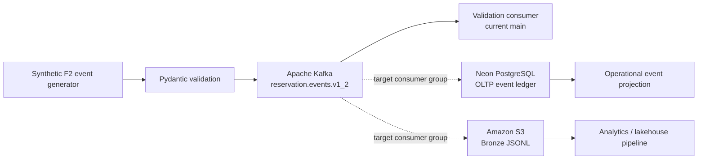

# 🏨 Buenavista | Hospitality Streaming Platform

<p align="center">
  <strong>Reliable reservation events for smarter hospitality operations.</strong><br/>
  <em>HospedaPlus · Data Engineering · F2 Channel-Manager Simulation</em>
</p>

<p align="center">
  
  
  
  
  
</p>

> [!IMPORTANT]
> **Current status: active development.** The default branch contains the Kafka producer, versioned reservation-event contract, and a validation consumer. Neon persistence, S3 Bronze persistence, production retry/dead-letter behavior, and cloud deployment must not be considered complete until their migrations, integration tests, and runtime checks have been executed and reviewed. The repository deliberately distinguishes implemented code from planned infrastructure.

## ✨ Project overview

Buenavista Streaming is the synthetic **F2 channel-manager event source** for the HospedaPlus data platform. It creates realistic, schema-validated reservation lifecycle events for a simulated hospitality portfolio and publishes them to a streaming broker.

The goal is to provide a repeatable, privacy-conscious source for testing ingestion, event validation, ordering, idempotency, operational projections, and analytics landing patterns—without connecting to a live guest or payment system.

### 🛎️ Hospitality context

| Project dimension | Current definition |
| --- | --- |
| Business domain | Hotel reservations and channel-manager activity |
| Simulated portfolio | 28 hotels across five countries; 4,000 rooms |
| Source domain | F2 — channel-manager events |
| Event format | Versioned JSON validated with Pydantic |
| Current event contract | **1.2** |
| Canonical reference data | Pinned catalog from `HospedaPlus/db_simulated` |
| Privacy | Synthetic data only; no direct guest identifiers or payment data |
| Main branch | `main` |

## 🧭 Architecture at a glance

The target design separates event publication from independent operational and analytical consumers. This keeps a slow or unavailable destination from requiring the producer to write directly to every system.



**Solid lines** represent the current implemented validation path. **Dotted lines** represent intended destination integrations; they are not a claim that live persistence or cloud resources are already configured.

### Design principles

- **Contract-first events:** validate payloads before they enter downstream processing.
- **At-least-once-friendly processing:** design consumers to tolerate redelivery and deduplicate by stable event identifiers.
- **Version-aware ordering:** use `reservation_id` and `reservation_version` to reconcile events that arrive out of order.
- **Separate responsibilities:** the event producer, OLTP projection, and Bronze capture should be independently deployable.
- **Safe evolution:** F2 events must not silently rewrite or corrupt F3's operational schema.
- **Cost-conscious infrastructure:** validate locally before requesting managed cloud resources.
- **No false deployment claims:** a successful broker acknowledgement is not proof of database or object-store persistence.

## 📨 Event lifecycle

The simulator supports six reservation event types:

| Event type | Hospitality meaning |
| --- | --- |
| `reservation.created` | A reservation is created |
| `reservation.updated` | Reservation details are modified |
| `reservation.cancelled` | A reservation is cancelled |
| `reservation.no_show` | The guest does not arrive |
| `reservation.checked_in` | The guest checks in |
| `reservation.checked_out` | The guest checks out |

A reservation can include zero to three modifications before its final outcome. Configurable out-of-order delivery helps test consumers that cannot assume creation always arrives before an update. All generated values are test data, not live hotel prices or guest records.

### Contract summary

The authoritative specification is [`docs/event-contract.md`](docs/event-contract.md).

| Field | Purpose |
| --- | --- |
| `event_id` | Stable UUID for event-level deduplication |
| `schema_version` | Contract version; currently `1.2` |
| `source` | Identifies the F2 channel-manager simulator |
| `event_type` | One of the six lifecycle events |
| `occurred_at` | Timezone-aware timestamp normalized to UTC |
| `hotel_id` | Canonical hotel code |
| `reservation_id` | Stable synthetic F2 reservation identifier |
| `reservation_version` | Monotonic lifecycle version for ordering |
| `data` | Minimal reservation facts and canonical codes |

The event's `reservation_id` is **not** the integer primary key of the F3 reservations table. A Neon projection must define an explicit mapping and preserve the original event. Statuses such as `modified`, `checked_in`, and `checked_out` must not be silently translated into an incompatible F3 status.

## 🧰 Technology stack

| Technology | Responsibility |
| --- | --- |
| Python 3.12+ | Event generation and consumer application |
| Pydantic 2 | Event schema validation |
| Apache Kafka / `confluent-kafka` | Streaming producer and consumer client |
| RabbitMQ / `pika` | Legacy implementation retained during migration |
| PostgreSQL on Neon | Intended OLTP event ledger and current-state projection |
| Amazon S3 | Intended raw Bronze landing destination |
| Docker Compose | Local broker and integration environment |
| pytest | Automated tests |
| Ruff | Python linting and formatting |
| GitHub Actions | CI, when configured and passing for the relevant commit |

RabbitMQ is retained during the migration to avoid removing a working legacy path before the Kafka path has been validated. It should not be described as removed until the migration is explicitly accepted and the repository's Compose files, documentation, tests, and operational dependencies agree.

## 🚀 Quick start

### Prerequisites

- Python 3.12 or newer
- Git
- Docker Desktop with Docker Compose v2
- A terminal (PowerShell on Windows, or Bash/Zsh on macOS/Linux)

### 1. Clone and install

**Windows PowerShell**

```powershell
git clone https://github.com/HospedaPlus/buenavista-streaming.git
cd buenavista-streaming
py -3.12 -m venv .venv
.\.venv\Scripts\Activate.ps1
python -m pip install --upgrade pip
python -m pip install -e ".[dev]"
Copy-Item .env.example .env
```

**macOS / Linux**

```bash
git clone https://github.com/HospedaPlus/buenavista-streaming.git
cd buenavista-streaming
python3.12 -m venv .venv
source .venv/bin/activate
python -m pip install --upgrade pip
python -m pip install -e ".[dev]"
cp .env.example .env
```

Review `.env.example` and set only the variables needed for the component being tested. Never commit a real password, API key, cloud credential, or connection URI. Keep local `.env` files out of Git.

### 2. Start the local Kafka broker

```powershell
docker compose -f docker-compose.kafka.yml config
docker compose -f docker-compose.kafka.yml up -d
docker compose -f docker-compose.kafka.yml ps
```

Check the broker logs if it does not become healthy:

```powershell
docker compose -f docker-compose.kafka.yml logs --tail 100
```

### 3. Create the versioned topic

```powershell
docker exec buenavista-streaming-kafka /opt/kafka/bin/kafka-topics.sh --bootstrap-server localhost:9092 --create --if-not-exists --topic reservation.events.v1_2 --partitions 3 --replication-factor 1
```

The local topic uses a replication factor of one. That is suitable for local development, **not** a high-availability production cluster.

### 4. Publish a bounded test batch

```powershell
python -m src.kafka_producer --count 20 --seed 42
```

The producer uses the reservation identifier as the Kafka message key and reports delivery failures. A successful publish confirms broker acceptance; it does not prove that a downstream sink has stored the event.

### 5. Run the validation consumer

Open a second terminal with the virtual environment activated:

```powershell
python -m src.kafka_consumer
```

The current validation consumer parses each message against the Pydantic event model and commits its offset after successful validation and processing. At this stage, its processor logs safe event metadata; it **does not write to Neon or S3**. Invalid messages are left uncommitted and stop the current consumer rather than being silently skipped. A production-ready dead-letter workflow remains a required acceptance item.

### 6. Run the Neon event-ledger consumer (optional; requires an approved migration)\n\nThe repository now includes a separate Kafka consumer that writes validated events to the additive `public.reservation_event_ledger` table. It does not modify F3 operational reservation records. Before running it, obtain the approved Neon connection URL and apply `migrations/001_create_reservation_event_ledger.sql` through the team’s migration process. Never run a destructive seed or reload command against the shared database.\n\nSet `NEON_DATABASE_URL` in your untracked local `.env` file or deployment secret store, then run:\n\n```powershell\npython -m pip install -e ".[dev]"\npython -m src.neon_consumer\n```\n\nThe consumer commits each Kafka offset only after the Neon transaction succeeds. Duplicate event IDs with the same payload are treated as already persisted; the same ID with a different payload raises an error. Invalid messages and database failures are left uncommitted. A dedicated retry/DLQ workflow is still required before production use.\n\n**This command has not been verified against the live Neon project in this session.** The migration must be applied and the connection tested before claiming live persistence.\n\n### 7. Run quality checks

```powershell
ruff check .
ruff format --check .
pytest
```

Run the checks after changing code and record the actual command output in the pull request or release notes. Do not mark a check as passing unless it was executed successfully.

## ⚙️ Configuration

Configuration examples are documented in [`.env.example`](.env.example). The exact variables depend on the component and deployment mode.

| Variable family | Used for |
| --- | --- |
| `KAFKA_BOOTSTRAP_SERVERS` | Kafka broker address |
| `KAFKA_RESERVATION_TOPIC` | Versioned reservation topic |
| `KAFKA_GROUP_ID` | Validation consumer group |
| RabbitMQ settings | Legacy producer and consumer |
| Database connection settings | Future or separately configured Neon sink |
| S3 / AWS settings | Future or separately configured Bronze sink |

Use placeholders in documentation and examples. Supply credentials through environment variables, a local untracked `.env` file, or the approved deployment secret manager. Do not paste secrets into source code, README files, issue descriptions, screenshots, or logs.

## 🗃️ Neon and S3 integration contract

The intended streaming architecture has two independent sink paths:

1. **Neon OLTP:** persist the immutable event in an inbox/ledger and maintain a monotonic current-state projection in one database transaction. Commit the Kafka offset only after the transaction succeeds.
2. **S3 Bronze:** preserve raw validated event records in partitioned objects, then commit offsets only after the object write is confirmed.

These are design requirements, not proof of a completed deployment. Before enabling either path, the team must review the additive SQL migration, validate the exact Neon schema and permissions, configure S3 access and partitioning, test replay/idempotency, and prove failure recovery.

### Data integrity rules

- Deduplicate by `event_id`.
- Do not overwrite a newer reservation state with an older `reservation_version`.
- Preserve the raw event for audit and replay.
- Resolve canonical hotel, room, and channel codes against the shared catalog.
- Do not fabricate guest identity or infer missing financial values.
- Keep F2's event history separate from F3's operational constraints unless an approved mapping is defined.
- Do not commit a Kafka offset before the required destination confirms durable persistence.

## 🛡️ Security and privacy

- Only synthetic reservation data belongs in this repository.
- Do not store guest names, emails, telephone numbers, payment details, or production reservation records in events, tests, or fixtures.
- Never commit credentials or connection strings.
- Use least-privilege roles for the broker, database, and object store.
- Keep local development credentials isolated and never expose development ports to untrusted networks.
- Redact secrets from logs and error reports.
- Rotate any credential that may have been exposed; removing it from the latest file alone does not remove it from Git history.

## 🧪 Testing strategy

| Test layer | What it should prove |
| --- | --- |
| Unit tests | Event generation, schema validation, ordering metadata, and error handling |
| Producer tests | Serialization, message keys, delivery callbacks, and failure reporting |
| Consumer tests | Offset commit ordering, shutdown, malformed events, retry, and dead-letter behavior |
| Contract tests | Exact catalog codes, allowed event types, and schema-version compatibility |
| Kafka integration tests | Topic configuration, publish/consume round trip, and restart behavior |
| Neon integration tests | Transactional inbox/projection, deduplication, rollback, and replay safety |
| S3 integration tests | Durable object writes, stable partition paths, and offset handling |
| End-to-end tests | Event generation through every approved destination |

## 📚 Repository guide

| Path | Purpose |
| --- | --- |
| `src/events.py` | Event schema, deterministic generation, and lifecycle data |
| `src/producer.py` | Legacy RabbitMQ publisher |
| `src/consumer.py` | Legacy RabbitMQ consumer |
| `src/kafka_producer.py` | Kafka event publisher |
| `src/kafka_consumer.py` | Kafka validation consumer; logs validated event metadata |\n| `src/neon_consumer.py` | Independent Kafka consumer that writes to the Neon event ledger after migration |\n| `src/neon_sink.py` | Idempotent Neon event-ledger persistence with Kafka provenance |
| `docker-compose.yml` | Legacy/local RabbitMQ environment |
| `docker-compose.kafka.yml` | Local Kafka environment |
| `docs/event-contract.md` | Versioned event contract and mapping constraints |
| `sql/streaming_schema.sql` | Proposed additive schema for streaming-owned data; requires review before applying |
| `tests/` | Automated test suite |
| `.env.example` | Configuration template without real credentials |

## 🗺️ Delivery checklist

- [x] Publish the synthetic F2 event contract at version 1.2.
- [x] Add the Kafka producer and validation consumer to the default branch.
- [x] Add local Kafka Compose configuration.
- [ ] Run the full test suite and Ruff checks on the current default-branch commit.
- [ ] Run Kafka broker integration tests from a clean environment.
- [ ] Complete and review the Neon schema migration before applying it.
- [x] Add an isolated Neon event-ledger sink and separate Kafka consumer to `main`.\n- [ ] Apply the reviewed event-ledger migration in Neon and verify live persistence.\n- [ ] Add automated sink tests and database integration tests.
- [ ] Implement and test S3 Bronze persistence.
- [ ] Add and verify bounded retries and a dead-letter workflow.
- [ ] Verify canonical catalog compatibility against the pinned source version.
- [ ] Validate end-to-end replay, idempotency, and offset behavior.
- [ ] Confirm security, monitoring, deployment ownership, and budget before production deployment.
- [ ] Update this checklist only when the corresponding evidence is available.

## 🏁 Definition of done

This repository can be called **production-ready** only when the approved architecture is implemented on `main`, automated checks pass, the event contract is agreed, Neon and S3 persistence are verified with integration tests, credentials are managed securely, failure recovery is demonstrated, and deployment/monitoring ownership is documented.

Until those checks are complete, the project status remains **development**, not production.

---

<p align="center">
  <strong>🏨 Buenavista Streaming · HospedaPlus</strong><br/>
  <sub>Thoughtful data engineering for dependable hospitality experiences.</sub>
</p>
