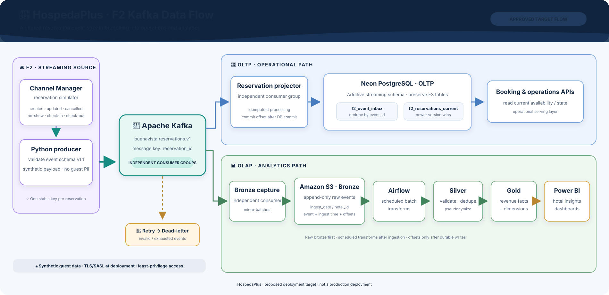

<div align="center">

# 🏨 HospedaPlus Streaming

### From the front desk to the data lake — one event at a time.

**The F2 Kafka pipeline for synthetic reservation events, operational projections, and analytics-ready Bronze data.**

[](https://www.python.org/)
[](https://kafka.apache.org/)
[](https://aws.amazon.com/s3/)
[](https://neon.tech/)
[](https://www.docker.com/)

🛎️ **Synthetic data** &nbsp; · &nbsp; 🔀 **Independent OLTP + OLAP paths** &nbsp; · &nbsp; 🗝️ **No direct guest PII**

</div>

---

## ✨ What this project does

HospedaPlus needs reservation events to serve day-to-day hotel operations and support trustworthy revenue analytics. This repository builds the **F2 streaming slice**: it simulates Channel Manager events, validates the shared event contract, and publishes them to Kafka. Two independent consumer groups then serve two different needs:

- **🏨 Operations (OLTP):** project events into an additive Neon schema for booking and operations APIs.
- **📊 Analytics (OLAP):** preserve raw events in Amazon S3 Bronze for scheduled Airflow processing into Silver and Gold.

The same event can serve both paths without making the operational database double as the analytics lake.

> **Architecture status:** this is the approved target flow and a development demonstrator. The AWS deployment guide is a proposal; production infrastructure has not been deployed.

## 🗺️ The flow at a glance

<div align="center">

<br>
<sub>🖱️ <a href="docs/architecture/hospedaplus-f2-kafka-flow.drawio">Open the editable Draw.io source</a> · <a href="https://app.diagrams.net/">Edit with diagrams.net</a></sub>
</div>

### How to read the diagram

1. **🛎️ Create a synthetic stay event.** The Channel Manager simulator emits reservation lifecycle events—created, updated, cancelled, no-show, check-in, and check-out. The Python producer validates schema **v1.1** and sends messages keyed by `reservation_id` to `buenavista.reservations.v1`.
2. **🔀 Fan out once, consume independently.** Kafka keeps separate offsets for each consumer group, so the operational projection and analytics capture can progress independently.
3. **🧾 Keep the operational view current.** The OLTP consumer inserts each `event_id` into `streaming.f2_event_inbox` and updates `streaming.f2_reservations_current` only when the incoming `reservation_version` is newer. Both writes share one Neon transaction; the Kafka offset is committed after that transaction succeeds. Booking and operations APIs read this projection.
4. **🌿 Preserve the analytics record.** The OLAP consumer batches raw events into S3 Bronze, partitioned by `ingest_date` and `hotel_id`. Each record retains event time, ingest time, and Kafka topic/partition/offset coordinates. The consumer commits offsets after the batch is written.
5. **✨ Shape data for decisions.** Scheduled Airflow jobs validate and deduplicate Bronze into Silver, pseudonymize before analytics, then build Gold revenue facts and dimensions for Power BI.
6. **🚨 Route failures for inspection.** Invalid events go to the dead-letter topic. Transient OLTP failures use bounded retries and go to the DLQ after the retry limit.

> **Delivery behavior:** Kafka-to-database and Kafka-to-S3 delivery is at-least-once. Replays are expected; the inbox deduplicates by event ID, and the Bronze records retain Kafka coordinates for reconciliation.

## 🧩 Event contract & data ownership

| Area | Contract |
|---|---|
| Event version | Schema **v1.1**, as approved for the F2 streaming flow |
| Main topic | `buenavista.reservations.v1` |
| Message key | `reservation_id` |
| Failure topics | `buenavista.reservations.retry.v1` and `buenavista.reservations.dlq.v1` |
| Guest data | Synthetic values only; no direct guest identifiers or payment details |
| Hotel catalog | 28 hotel IDs aligned with Melissa’s canonical [db_simulated catalog](https://github.com/HospedaPlus/db_simulated/tree/main/catalog) |
| Neon boundary | Additive `streaming` schema; F3-owned tables stay with the database workstream |

The hotel ID list follows Melissa’s shared catalog. **Channel and room-type values still need to be aligned with the F3 catalog before analytics joins are treated as authoritative.** The proposed migration is [`sql/streaming_schema.sql`](sql/streaming_schema.sql); it has not been applied to the shared Neon database.

## 🪄 New to Kafka?

Start with [Kafka from zero: HospedaPlus edition](docs/kafka-from-zero.md) for a hotel-themed introduction and a hands-on exercise that lets you read the same topic from two independent consumer groups.

## 🚀 Run the demonstrator locally

**You’ll need:** Docker Compose and Python 3.12 or later.

```bash
git clone https://github.com/HospedaPlus/buenavista-streaming.git
cd buenavista-streaming
cp .env.example .env
docker compose up -d kafka
python -m venv .venv
# Activate the virtual environment, then:
python -m pip install -e ".[dev]"
python -m src.producer --count 20 --seed 42
```

Start the operational projector and Bronze capture in separate terminals:

```bash
python -m src.consumer
python -m src.bronze_consumer
```

Follow the [local runbook](docs/runbook.md) for topic creation, database setup, continuous simulation, and shutdown. The local broker is a single-node KRaft setup with PLAINTEXT security for development.

## ☁️ Deployment migration

The first deployment step is containerizing the same three runtime commands. The non-root image is defined in [`Dockerfile`](Dockerfile); the staged AWS proposal is in [`deploy/aws/README.md`](deploy/aws/README.md).

**Proposed hosting shape:** Amazon MSK → separate ECS/Fargate producer, Neon projector, and S3 capture tasks → Amazon S3 Bronze. Neon remains the OLTP destination; Airflow and Silver/Gold remain data-platform responsibilities.

Production rollout still needs approved AWS account/network inputs, Kafka authentication selection, topic and retention sizing, a reviewed Neon migration, catalog alignment, and operational/cost review. Kafka TLS/SASL configuration is available to the Python clients; credentials must come from the approved secret store at runtime. **No AWS resources have been provisioned, and no Neon migration has been applied.**

## 👥 Team handoff

Keep this repository’s event contract and architecture aligned with the tech lead’s approved diagram. **Vane is responsible for uploading the agreed documentation changes to Docusaurus.** Oscar, Melissa, and Johana coordinate the shared channel and room-type catalog values before downstream analytics depend on them.

## 📚 Project map

| Path | What lives here |
|---|---|
| `src/producer.py` | Synthetic event publisher |
| `src/consumer.py` | Neon OLTP projection consumer |
| `src/bronze_consumer.py` | S3 Bronze OLAP capture consumer |
| `src/events.py` | Schema v1.1 event definitions and generator |
| `docs/architecture/` | Editable Draw.io source and README diagram |
| `docs/event-contract.md` | Event and delivery contract |
| `docs/runbook.md` | Local setup and operation |
| `sql/streaming_schema.sql` | Proposed additive Neon schema |
| `deploy/aws/README.md` | AWS migration plan and deployment gates |

---

<div align="center">

**🏨 HospedaPlus · Better signals for better stays.**

<sub>Proposed architecture and project targets are not production guarantees. AWS costs must be validated in the AWS Pricing Calculator.</sub>

**README author:** Johana Bolivar  
**Project:** HospedaPlus

</div>
